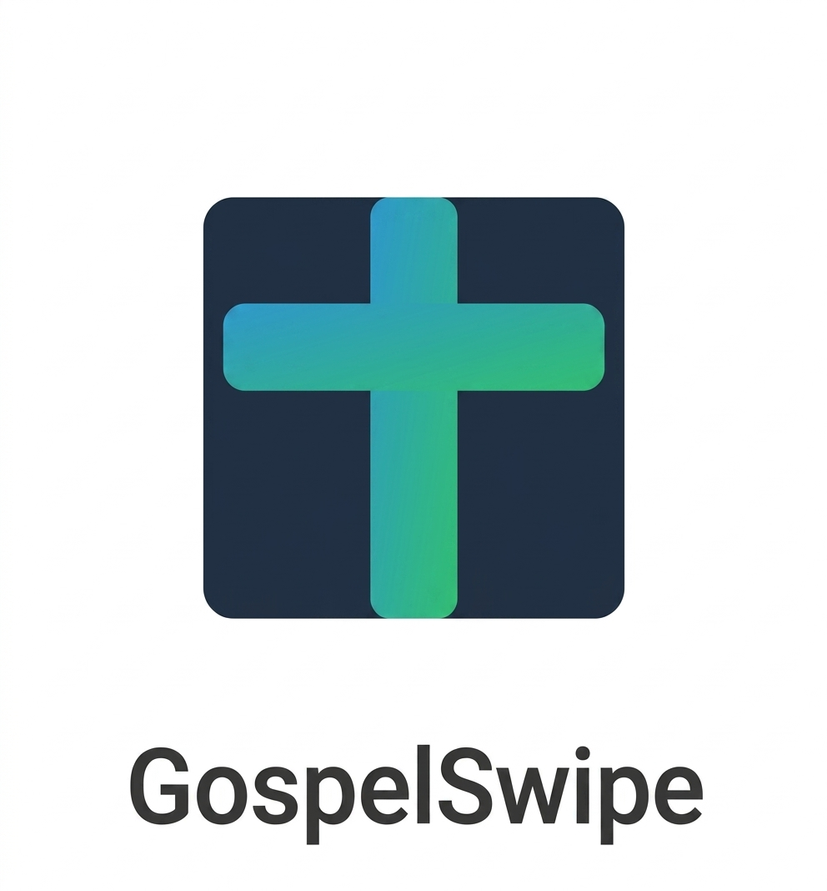

  

<h1 align="center">GospelSwipe Pro</h1>

  <strong>Your pocket evangelism toolkit.</strong> 
  Offline-first PWA · Made in Nigeria 🇳🇬 · Free forever

  
  
  

  <a href="https://gospelswipe.app"><strong>Open the app →</strong></a>
  &nbsp;·&nbsp;
  <a href="https://www.givesendgo.com/gospelswipe-put-the-gospel-in-every-pock">GiveSendGo</a>
  &nbsp;·&nbsp;
  <a href="https://selar.com/showlove/gospelswipe">Support on Selar</a>

---

GospelSwipe Pro is an **offline-first Christian evangelism PWA** built so any believer — on a basic Android phone, with or without data — can share the gospel, pray, train, and follow up new disciples.

No app store. No ads. No tracking. Add to Home Screen and it works.

Built by **Haggai Enitan** at **GP Tech Studio**, Lagos, Nigeria.

## What is in the app today (v2.0.8)

| Module | What you get |
|---|---|
| **15 gospel slides** | Swipe presentation with listen, explain, share, and verse-image |
| **Daily Devotional** | 56 weekly devotionals — verse, reflection, prayer, action |
| **Living Faith** | 53 weekly reflections — thought, anchor verse, “sit with this” |
| **The Thread** | 60 Bible themes traced Genesis → Revelation |
| **Gospel Tracts** | 200 full written tracts (conviction, salvation, backslider, peace, identity, struggle, urgency) |
| **Evangelism Training** | Romans Road · The Bridge · Three Circles |
| **New Believer Guide** | 7-day start for someone who just said yes to Jesus |
| **Prayer Guide** | 200 written prayers across 5 categories + voice journal |
| **Soul Journal** | Log every gospel conversation and decision |
| **Audio Mode** | Hear slides and devotionals offline (device TTS) |
| **WhatsApp Invite** | One-tap gospel link to share |
| **VOM / Persecution Mode** | Real calculator disguise + PIN unlock + encoded prayers |
| **8 languages** | English, Yoruba, Igbo, Hausa, Pidgin, Français, Kiswahili, العربية |

Coming soon (preview in-app): 30/60/90-day discipleship track, local church finder, live impact dashboard, SMS / USSD gospel access, testimony wall.

## Languages

UI chrome is translated in all **8 languages**.

**Yoruba content (one language at a time, by design):**

- Done: slides, evangelism training, new believer guide, devotionals, living faith, struggle tracts, prayer-category labels
- Next: The Thread → remaining tracts → 200 prayer texts → then French, Swahili, Arabic, Igbo, Hausa, Pidgin

Other languages fall back to English for module bodies until their pass is complete.

## Privacy & persecution

- 100% **local storage** (IndexedDB + localStorage)
- **Zero analytics / zero tracking**
- Open source and auditable
- **VOM Mode** hides the whole app behind a working calculator. Type your 4-digit PIN + `=` to return. Prayers are encoded while disguised.

This is for believers in hostile contexts — not a toy icon swap.

## Install (no app store)

1. Open **[gospelswipe.app](https://gospelswipe.app)** in Chrome, Kiwi, or Safari
2. Android: browser menu → **Add to Home Screen** (or the in-app Install button)
3. iPhone / iPad: Share → **Add to Home Screen**
4. Works offline after first load

## Tech

Vanilla HTML / CSS / JS PWA. Service worker cache `gospel-swipe-v2.0.8`. Hosted on GitHub Pages with custom domain `gospelswipe.app`.

Core files: `index.html` · `app.js` · `style.css` · `sw.js` · `manifest.json` · content modules (`devotionals.js`, `livingfaith.js`, `thread.js`, `tracts.js`, `prayers.js`, …) · i18n loaders (`translations.js`, `*_i18n.js`).

Premium (optional): **$1.99/month** — AI apologetics engine and church dashboard (in progress). The core gospel toolkit stays free.

## $25,000 grant

Building gospel infrastructure for the next generation of African believers.

| Item | Amount |
|---|---|
| Development laptop | $3,500 |
| AI API credits (12 months) | $14,000 |
| CDN & hosting (12 months) | $1,200 |
| Outreach marketing | $6,300 |
| **Total request** | **$25,000** |

**Impact snapshot (in-app Mission Impact):** 1,247 beta users · 8,934 verses shared · 3,456 prayers saved · $0.37 cost per soul · 50K conversion target.

> “It has impressive features, particularly its multilingual capabilities, tool for evangelism, and its effectiveness as a tool for church growth. Also, it is unique in highlighting often overlooked aspects of gospel apps, such as the persecution of Christians.”
> — **Lucky Ossai**, Nigerian believer, Netherlands

## Support this ministry

GospelSwipe Pro is free and will stay free. Gifts fund development and outreach in Nigeria.

- [GiveSendGo campaign](https://www.givesendgo.com/gospelswipe-put-the-gospel-in-every-pock)
- [Selar — any amount](https://selar.com/showlove/gospelswipe) · [Partnership ₦5,000](https://selar.com/0306077o80)
- [Ko-fi](https://ko-fi.com/gospelswipe) · [Open Collective](https://opencollective.com/gospelswipe)

Partnership certificates: [certificate.html](https://gospelswipe.app/certificate.html)

## Founder

**Haggai Enitan** · GP Tech Studio · Lagos, Nigeria  
[haggai.enitan.dev@gmail.com](mailto:haggai.enitan.dev@gmail.com) · [GitHub @GPmulticoncept](https://github.com/GPmulticoncept)

Built to prove the gospel spreads regardless of circumstances — including a broken laptop.

## License

[MIT](LICENSE) © 2026 Haggai Enitan / GP Tech Studio (GPmulticoncept)
